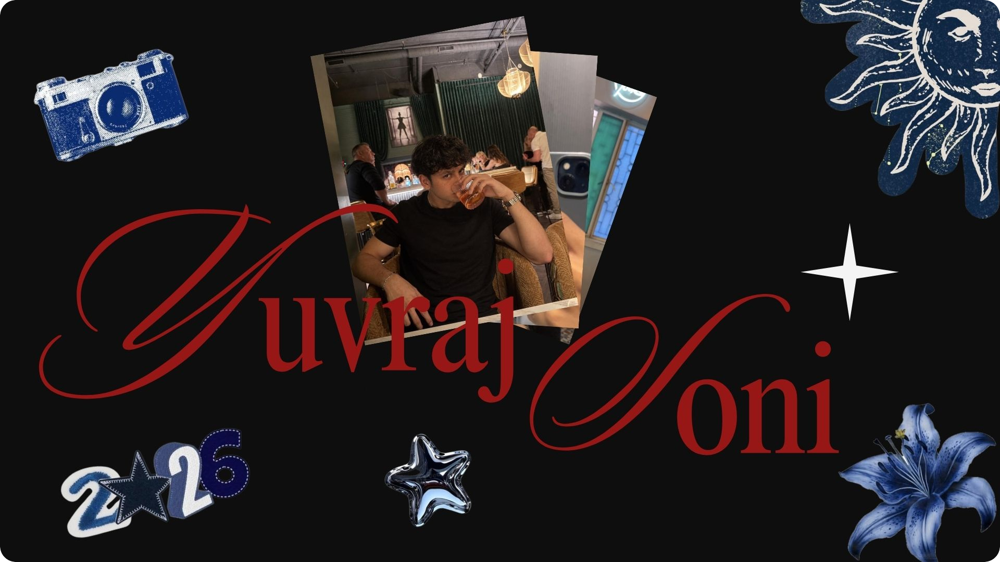

---

<table>
<tr>
<td width="60%" align="top">
<h3>Hey, I'm Yuvraj 👋</h3>

I've been coding for around three years now. Most of that time has gone into building websites, full-stack applications, mobile apps, and whatever else I find interesting enough to spend my time on.

I like making things from scratch, breaking them, fixing them, and sometimes wondering why I decided to build them in the first place. There's something satisfying about having an idea in your head and turning it into something that actually works.

When I'm not coding, I'm probably at the gym, exploring cafes, looking for good food, or finding an excuse to go somewhere new. I like keeping things interesting outside the screen too.

Nothing too serious. Just me, figuring things out and building along the way.

</td>
<td width="40%" align="center" valign="middle">

</td>
</tr>
</table>

[**Portfolio →**](https://yuvrajj.is-a.dev) &nbsp;&nbsp; [**Resume →**](https://yuvrajj.is-a.dev/Yuvraj-Soni-Resume.pdf)
